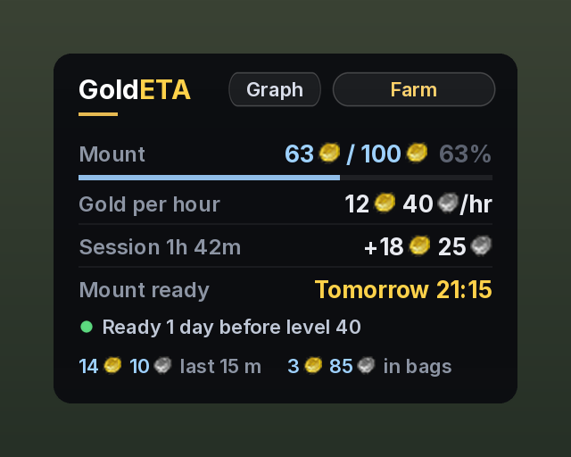
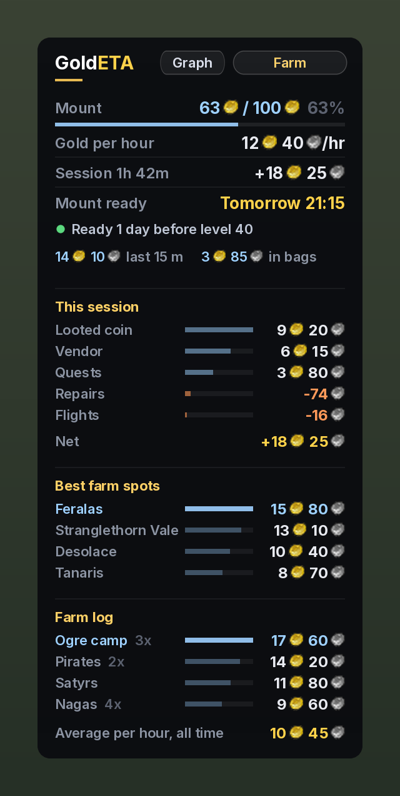
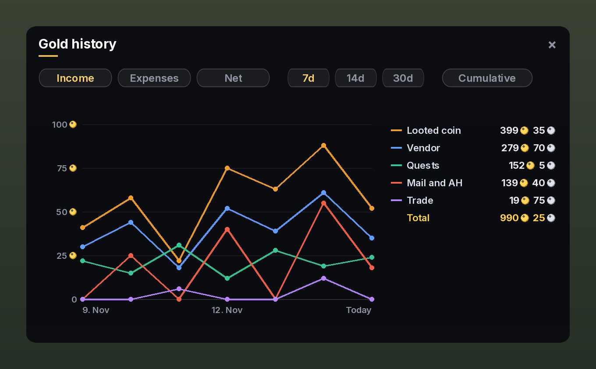
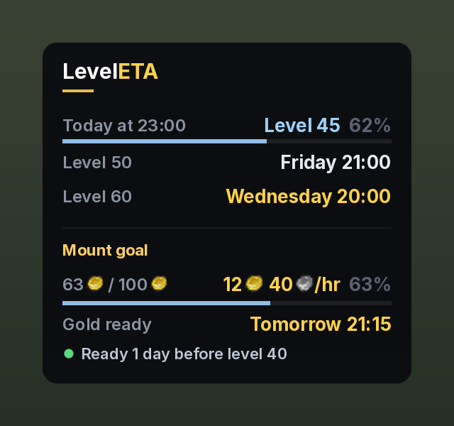
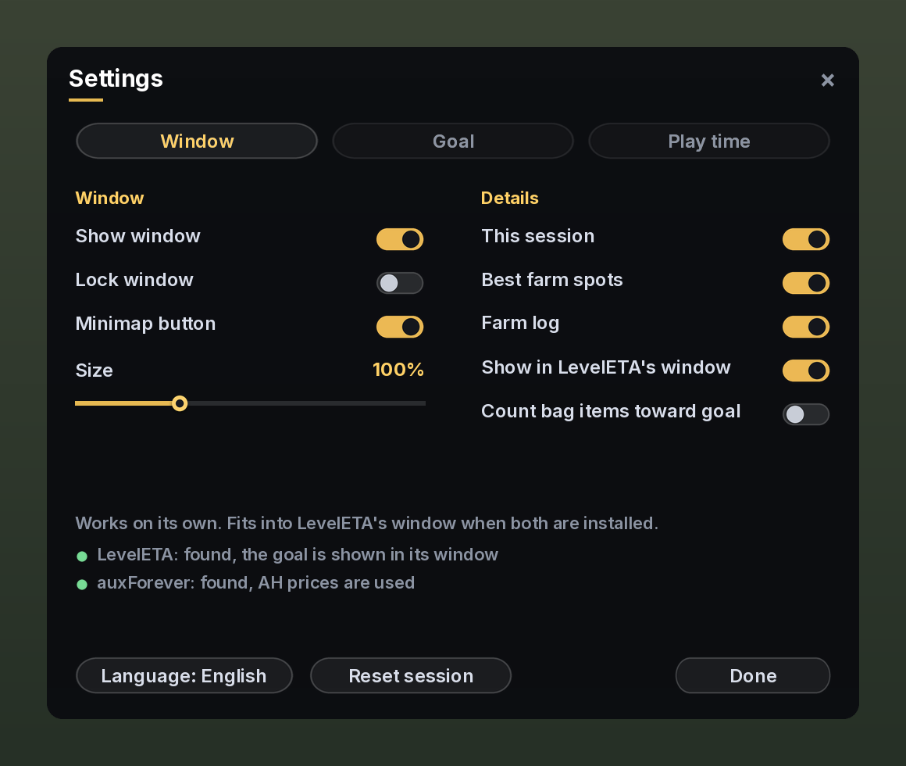

# GoldETA

**GoldETA tells you how much gold you make per hour, and when you can afford your mount.**

Part of the ETA family with [LevelETA](https://github.com/Nielsen2211/LevelETA). Each works on its own, and together they share one window.

- **Gold per hour**, measured over your last 2 hours of play, plus your pace for the last 15 minutes
- **When your goal is ready**, as a real date like *Tuesday 21:00*, using your play times
- **Farm runs**: start and stop a recording and see which spots pay the most
- **Where your gold comes from**: looted coin, vendor, quests, mail and AH, and what you spend on repairs, flights and training
- **Works with LevelETA**: your mount goal shows up in LevelETA's window, and tells you if you have the gold before level 40

- **Small graph** of your gold per hour for the last 4 hours, and gold per hour in green or orange when you are above or below your own average
- **Compact and simple window**: right click the window to go full, compact (gold per hour and goal) or simple (only gold per hour). Also `/geta compact` and `/geta simple`. Remembered per character
- **Characters**: gold, gold per hour and goal for every character on your account (`/geta chars`)
- **AuctionMaster**, auxForever and Auctionator prices for your items

Every amount is shown with the game's own gold, silver and copper icons.

---

## The window

GoldETA starts small, with just your gold per hour. Click it to unfold the window, and it remembers how you left it, per character. The unfolded window shows your gold per hour, your goal with a progress bar and when you will reach it, and one button to start a farm run. Click **More** to show everything else (session, last 15 minutes, the graph, your sources of gold, best farms and the farm log). Right click the window to switch between the normal window, only the numbers, and one line. **Characters** shows all your characters.

The older rows below are still all there under **More**.

| Row | What it tells you |
|---|---|
| **Mount 47 of 100** | How close you are to your goal, your gold per hour and a progress bar |
| **Session 1h 42m** | How much you are up (or down) since you logged in |
| **Mount ready** | When you will have the gold, at your current pace and play times |

Under the rows you see your gold per hour for the last 15 minutes and what the items in your bags are worth.

Under the rows you can show three sections. Turn each on or off in the settings, under Details:

- **This session**: your income and spending split into categories
- **Best farm spots**: gold per hour for every zone where you have farmed at least 10 minutes
- **Farm log**: your farms sorted by gold per hour, best at the top

## Gold history

Click **Graph** at the top of the window (or `/geta graph`) to open your gold history:

- **Income**, **Expenses** or **Net**: a line per source (looted coin, vendor, quests, mail and AH, repairs, flights and so on), one point per day
- **7, 14 or 30 days**, and **Cumulative** to see the totals grow over the period
- A legend with the total per source, and the total for the period
- Hover a day to see every source for that day

The history starts when you install this version and fills up as you play.

## Farm runs

Click **Farm** at the top of the window (or use `/geta farm`, Shift click the minimap button, or set a key under Key Bindings, AddOns).

While a run is going you see a timer, gold per hour for the run, the total, looted coin, the value of the items you looted, kills and your top loot. You can pause it. When you stop, you can give the run a name (it suggests the zone and the mob you killed the most) and it is saved to your farm log.

### Farm log

Every run you save with the same name is added to that farm, so the log shows each farm's real average gold per hour over all its runs, how many runs it has, and your best run. The details show your top 6, and `/geta log` prints the whole log in chat, best first.

A run counts what you loot, not your bag of money. So an item only counts once, even if you sell it to a vendor in the middle of the run.

## Your goal

The default goal is **Mount, 100 gold**, compared with level 40. Pick **No goal** if you only want gold per hour, your session and the logs; the goal rows and the section in LevelETA's window are then hidden. In the settings you can pick **Epic mount** (1000 gold, level 60) or set any amount and level. You can also choose to count the items in your bags toward the goal.

Your pace counts all income minus what farming costs you (repairs and flights). Training, AH buys and other shopping are choices, so they do not drag your pace down.

## With LevelETA

When [LevelETA](https://github.com/Nielsen2211/LevelETA) is installed:

- A small **Mount goal** section appears in LevelETA's window, right under the rows for your next levels
- It shows your gold, gold per hour, when the gold is ready, and a line like **Ready 2 days before level 40** (green) or **5h after level 40** (orange)
- GoldETA uses LevelETA's play times, so both addons agree on when you play
- GoldETA's own window starts hidden. Click its minimap button to see everything
- LevelETA keeps a small gold history in the background, so GoldETA shows your gold per hour and mount time from the very first login

You can turn this off in GoldETA's settings with **Show in LevelETA's window**.

If you show both windows, drag GoldETA's window next to LevelETA's and it clicks into place under, over, left or right of it. Once docked it follows LevelETA when you move it or when its height changes, so the two never overlap. Drag it away to undock.

## With AuctionMaster, auxForever or Auctionator

If AuctionMaster is installed, GoldETA uses its market price for item values. Otherwise, if auxForever is installed, GoldETA uses its usual AH price for item values (the same price aux uses to find deals). If not, it uses Auctionator's prices. Without either, vendor prices are used. An item is never valued below its vendor price.

## Minimap button

- **Left click**: show or hide the window
- **Right click**: settings
- **Shift click**: start or stop a farm run
- **Hover**: gold per hour, when your goal is ready, and the gold on all your characters

## Commands

| Command | What it does |
|---|---|
| `/geta` | Settings |
| `/geta show` | Show or hide the window |
| `/geta farm` | Start or stop a farm run |
| `/geta graph` | Your gold history |
| `/geta chars` | Gold, gold per hour and goal for all your characters |
| `/geta compact` | Compact or full window |
| `/geta simple` | Only gold per hour, or back |
| `/geta log` | Your farm log in chat, best gold per hour first |
| `/geta summary` | A short summary of this session |

## Languages

English and Danish. Switch in the settings.

## License

MIT
